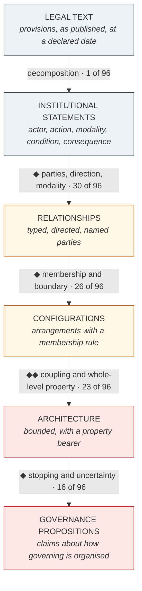
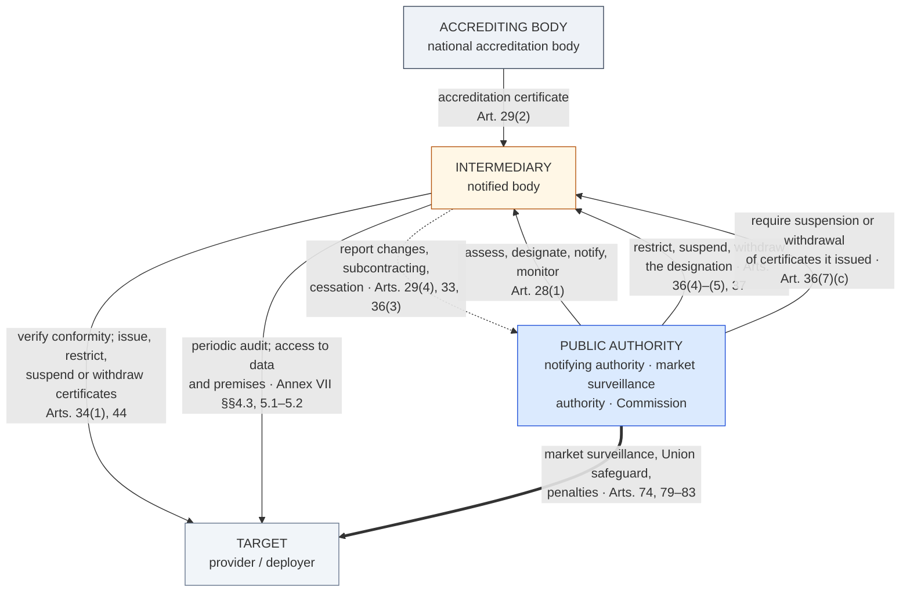

# 08 — Figures

Three figures. Each has a Mermaid version and a plain-text fallback that carries the same information, so the note is readable wherever Mermaid is not rendered.

---

## Figure 1 — From legal coding to architecture: where judgment enters

The ladder is David's (§6.2). What the figure adds is the location of the judgment: the four transitions marked ◆ are the ones the pilot found to be the site of disagreement, and the figure records how many of the 96 material differences arose at each level.



**Plain-text fallback**

```
LEGAL TEXT
   |  decomposition into statements          ....  1 of 96 material differences
   v
INSTITUTIONAL STATEMENTS
   |  DIAMOND  parties, direction, modality  .... 30 of 96
   v
RELATIONSHIPS
   |  DIAMOND  membership and boundary       .... 26 of 96
   v
CONFIGURATIONS
   |  DIAMOND DIAMOND  coupling; which property
   |  attaches to the whole rather than the part
   |                                         .... 23 of 96
   v
ARCHITECTURE
   |  DIAMOND  stopping level; uncertainty   .... 16 of 96
   v
GOVERNANCE PROPOSITIONS

DIAMOND = a transition requiring judgment, not extraction.
Counts are material differences between two reconstructions of the same four
instruments from the identical frozen corpus (Round 1, 2026-10-07; 96 material
differences out of 264 comparative units).

Reading: agreement is concentrated at the bottom of the ladder and disagreement
at the top. The lowest transition produced one material difference across four
instruments; the three upper transitions produced sixty-five.
```

---

## Figure 2 — The controls that survived, placed at the transition they discipline

This figure shows the simplified residue from `05_METHOD_CONTROLS_REVIEW.md`, not the full procedural apparatus. Everything shown is retained; the 19-table schema and the six-stratum identifier system are not.

```mermaid
flowchart LR
    subgraph T1["Text → Statements → Relationships"]
      P1["source hash, coverage,<br/>legal status and reference date"]
      P2["named parties; modality;<br/>no fabricated counterparty"]
    end
    subgraph T2["Relationships → Configurations"]
      P3["membership rule stated<br/><i>(stated, not multiplied)</i>"]
    end
    subgraph T3["Configurations → Architecture"]
      P4["one coupling question:<br/>what coupling, and what property<br/>attaches to the whole?"]
      P5["external constitutive<br/>dependency flagged"]
      P6["candidate status —<br/>earned, not assumed"]
    end
    subgraph T4["Architecture → Proposition"]
      P7["stopping level recorded;<br/>'no architecture warranted' available"]
      P8["one rival grouping;<br/>coverage statement for<br/>absence-dependent claims"]
      P9["uncertainty travels<br/>with the claim"]
    end
    T1 --> T2 --> T3 --> T4

    style T1 fill:#eef2f7,stroke:#334155
    style T2 fill:#fff7e6,stroke:#b45309
    style T3 fill:#fde8e8,stroke:#b91c1c
    style T4 fill:#fde8e8,stroke:#b91c1c
```



**Plain-text fallback**

```
TRANSITION                          CONTROL RETAINED
--------------------------------------------------------------------------
text -> statements -> relations      source hash, coverage, legal status
                                     and reference date
                                     named parties; modality; no fabricated
                                     counterparty

relations -> configurations          membership rule stated
                                     (stated once at the granularity the
                                     question needs, not multiplied)

configurations -> architecture       ONE coupling question: what legally
                                     evidenced coupling joins these, and what
                                     property follows for the whole rather
                                     than for each part?  (indeterminate is
                                     an authorised answer)
                                     external constitutive dependency flagged
                                     candidate status: earned, not assumed

architecture -> proposition          stopping level recorded; "no architecture
                                     warranted" available as a result
                                     one rival grouping; coverage statement for
                                     any absence-dependent property
                                     uncertainty travels with the claim

Note: the weight of the controls sits on the two upper transitions. That is
where the pilot's disagreements were, and where a generative executor will
complete what the evidence does not warrant.
```

---

## Figure 3 — Intermediation embedded in hierarchy

Supported at relation level for Regulation (EU) 2024/1689 and, with the external-dependency caveat, for Regulation (EU) 2023/956 and Directive 86/361/EEC. Provisions shown are from the AI Act, which constitutes the whole chain internally. The dashed arrow is the point the pilot's external-dependency control makes visible: in CBAM and in 86/361 that part of the chain is constituted outside the instrument.



**Plain-text fallback**

```
          ACCREDITING BODY                 PUBLIC AUTHORITY
       national accreditation body     notifying authority / market
                                       surveillance authority / Commission
                  |                               |
   accreditation  |          assess, designate, notify, monitor  [Art. 28(1)]
   certificate    |          restrict / suspend / withdraw the
   [Art. 29(2)]   |            designation  [Arts. 36(4)-(5), 37]
                  |          require suspension or withdrawal of
                  |            certificates issued  [Art. 36(7)(c)]
                  v                               v
                 +--------------------------------+
                 |          INTERMEDIARY          |
                 |         notified body          |
                 +--------------------------------+
                  |         ^                      \
                  |         |  report changes,       \  market surveillance,
   verify          |        |  subcontracting,        \  Union safeguard,
   conformity;     |        |  cessation               \  penalties
   issue/restrict/ |        |  [Arts. 29(4), 33,        \ [Arts. 74, 79-83]
   suspend/withdraw|        |   36(3)]                   \
   certificates    |        |                             \
   [Arts. 34, 44]  |        +------- to authority           \
   periodic audit; |                                         \
   access to data  v                                          v
   and premises   +--------------------------------------------+
   [Annex VII]    |                  TARGET                    |
                  |            provider / deployer             |
                  +--------------------------------------------+

Read: governing work is routed through the intermediary; no consequential
public power is transferred to it. Authorization, designation, market
surveillance, safeguard review and sanction remain public, and the
intermediary's own authority is revocable by the authority that conferred it.

CAVEAT the external-dependency control makes visible: in CBAM the accreditation
and supervision of the verifier is constituted OUTSIDE the Regulation
(Reg. 765/2008 Art. 4(1); Implementing Reg. 2018/2067), and in Directive
86/361 the status of "approved testing laboratory" is fixed by the CEPT
accreditation system, outside the Directive. The same picture drawn from those
instruments alone would be missing its top-left corner.

LIMIT: this is formal legal architecture. It establishes channels and
revocability, not whether designations are withdrawn, audits find anything, or
oversight is effective.
```

---

## Note on what the figures deliberately omit

No figure shows counts of records, relations, tables or artefacts, and none ranks the two procedures. Under the frozen materiality rule, output volume is never evidence of quality, and a figure that displayed 1,163 records against 38 would imply exactly the comparison the exercise forbids.
