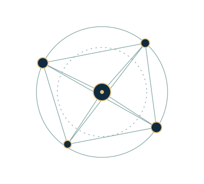

::: {.rio-hero}
::: {.hero-copy}
[REGULATORY INTERMEDIARIES OBSERVATORY]{.eyebrow}

# Researching the relationships shaping regulation. {.hero-title .unnumbered}

Researching the actors, relationships, and institutions shaping regulatory governance. A proposed platform for scientific exchange, independent research and evidence-informed discussion.

::: {.hero-actions}
[Explore the research](research.qmd){.rio-button}
[About the Observatory →](about.qmd){.hero-secondary}
:::
:::
::: {.hero-art aria-hidden="true"}
{fig-alt=""}

[ACTORS · RELATIONSHIPS · INSTITUTIONS]{.motif-label}
:::
:::

::: {.section-intro}
[01 / THE OBSERVATORY]{.eyebrow}

## A place for research to connect.

The Observatory is being developed as a shared space for work on regulatory intermediation and governance. It will bring together research projects, methodological discussions and documented resources, while respecting the independence of each contributing initiative.

[Our mission and editorial approach →](about.qmd){.text-link}
:::

::: {.research-areas}
[02 / RESEARCH AREAS]{.eyebrow}

## Questions across regulatory governance

::: {.area-grid}
::: {.area-item}
### Actors & institutions

A space for work examining the organizations, people and institutional settings involved in regulation.
:::
::: {.area-item}
### Relationships & intermediation

A space for research on how regulatory responsibilities and activities connect across actors.
:::
::: {.area-item}
### Methods & evidence

A space for methodological exchange on sources, research design and transparent scientific communication.
:::
:::
:::

::: {.feature-grid}
::: {.feature-panel}
[03 / RESEARCH PROJECTS]{.eyebrow}

## Independent work. Shared visibility.

Project pages will present approved overviews, questions, contributors and related outputs. No research initiative is currently listed as an affiliated project.

[Explore research projects →](research.qmd){.text-link}
:::
::: {.feature-panel .resource-panel}
[04 / DATASETS & RESOURCES]{.eyebrow}

## Context for research outputs.

A future catalog will describe approved datasets and link to their documentation and custodians. The underlying research and data remain with their producing initiatives.

[Visit datasets & resources →](dataset.qmd){.text-link}
:::
:::

::: {.notes-section}
[05 / RESEARCH NOTES]{.eyebrow}

## Latest from the research notebook

::: {.editorial-empty-state}
**A notebook ready for its first contribution.**

Reviewed research notes, methodological discussions and project updates will appear here when approved. There are no published research notes yet.
:::

::: {#latest-notes}
:::

[Browse the research notebook →](blog.qmd){.text-link}
:::
