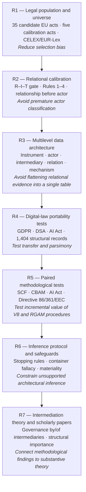

# PRJ-David — Governance Architecture and Regulatory Intermediation

## Research history, workstreams and catalogue of outputs (R1–R7)

> **Repository purpose.** This repository documents the cumulative research undertaken by Igor Caires Machado in collaboration and methodological dialogue with David Levi-Faur and Rotem Medzini. It preserves successive research protocols, evidence, coding exercises, tests, scholarly notes and presentations. Historical records and versioned data should not be treated as final findings merely because they are stored here.

> **Language and provenance.** English is the language of this repository's main navigation and current presentation materials. Some archival file and folder names, legal-source transcriptions and dated evidence records retain their original wording and paths to preserve reproducibility, checksums and source references.

---

## Quick access — manuscript drafts and interactive presentations

### Manuscripts

| Version | Open document | Description |
|---|---|---|
| **Manuscript draft V8 (David Levi-Faur)** | [Open V8 DOCX in GitHub](https://github.com/PRJ-REGULATORY-INTERMEDIARIES/Prf-David/blob/main/06_R6_ARCHITECTURAL_INFERENCE_SAFEGUARDS/01_RGAM_Materiality_First/RGAM/source_context/david_v8_2026-10-03/draft%20v8%20%20%20Law_and_Governance_Architectures_Revised.docx) | Working manuscript *Law and Governance Architectures*, preserved as the conceptual and editorial reference for the methodological work. |
| **Manuscript draft V9 (Igor's proposed revision)** | [Open V9 DOCX in Google Drive](https://docs.google.com/document/d/1jSo_YRa6f-LpYiNtcgWdZFRKvs8rO55G/view) | External working document containing proposed revisions and comments; not presented as an author-approved replacement for V8. |

**Editorial and access note:** V8 and V9 are working drafts rather than published articles. V9 is linked from Drive, not copied into this public GitHub repository. Review its Google Drive sharing permissions before distributing this README beyond the research team.

### Browser-based HTML presentations and research interfaces

The following inventory lists **interactive or presentation-oriented HTML interfaces**, rather than the many raw legal texts, captured webpages and archival HTML fixtures included for research provenance. Where duplicate copies exist, one canonical link is listed.

| HTML interface | Content and purpose | Open or preview | Current status |
|---|---|---|
| **Current: Rotem–Igor Research Atlas** | Interactive comparison of Rotem's historical intermediary-centred coding with Igor and David's V8/RGAM relational-architectural work, including methodological flows, four cases, convergence matrix, English/Portuguese option. | [View file in GitHub](https://github.com/PRJ-REGULATORY-INTERMEDIARIES/Prf-David/blob/main/docs/rotem-igor-comparison/index.html) · [Preview in browser](https://htmlpreview.github.io/?https://raw.githubusercontent.com/PRJ-REGULATORY-INTERMEDIARIES/Prf-David/main/docs/rotem-igor-comparison/index.html) | Current presentation; HTML committed to `main`; GitHub Pages publication not verified. |
| **V8 interactive article — From Legal Text to Governance Architecture** | Explains the evidence-to-architecture reasoning sequence, eight inferential operations, interactive element selection, multidimensional configurations and a GDPR illustration. | [View file in GitHub](https://github.com/PRJ-REGULATORY-INTERMEDIARIES/Prf-David/blob/main/06_R6_ARCHITECTURAL_INFERENCE_SAFEGUARDS/01_RGAM_Materiality_First/RGAM/V8_ACTIVE/06_INTERACTIVE_ARTICLE/index.html) · [Preview in browser](https://htmlpreview.github.io/?https://raw.githubusercontent.com/PRJ-REGULATORY-INTERMEDIARIES/Prf-David/main/06_R6_ARCHITECTURAL_INFERENCE_SAFEGUARDS/01_RGAM_Materiality_First/RGAM/V8_ACTIVE/06_INTERACTIVE_ARTICLE/index.html) | Research/illustrative interface; directory name does not certify public deployment. |
| **R4.2B — Human QA Review Panel** | Supports human inspection of legal source excerpts and context against machine-extracted fields; provides a researcher review interface. | [View file in GitHub](https://github.com/PRJ-REGULATORY-INTERMEDIARIES/Prf-David/blob/main/04_R4_DIGITAL_LAW_VALIDATION/01_Extracao_Estrutural_Cross_Domain/R4_CROSS_DOMAIN_VALIDATION/03_extraction/qa/human_review/R4_2B_HUMAN_REVIEW_PANEL.html) · [Preview in browser](https://htmlpreview.github.io/?https://raw.githubusercontent.com/PRJ-REGULATORY-INTERMEDIARIES/Prf-David/main/04_R4_DIGITAL_LAW_VALIDATION/01_Extracao_Estrutural_Cross_Domain/R4_CROSS_DOMAIN_VALIDATION/03_extraction/qa/human_review/R4_2B_HUMAN_REVIEW_PANEL.html) | Internal QA instrument; alternative copy in the R4 package sent to David. |
| **R4.2D — Human Diagnostic Panel** | Presents candidate cross-model-supported extraction defects, relevant legal passages and structured fields for a researcher's correction and notes. | [View file in GitHub](https://github.com/PRJ-REGULATORY-INTERMEDIARIES/Prf-David/blob/main/04_R4_DIGITAL_LAW_VALIDATION/01_Extracao_Estrutural_Cross_Domain/R4_CROSS_DOMAIN_VALIDATION/03_extraction/qa/repair/R4_2D_HUMAN_DIAGNOSTIC_PANEL.html) · [Preview in browser](https://htmlpreview.github.io/?https://raw.githubusercontent.com/PRJ-REGULATORY-INTERMEDIARIES/Prf-David/main/04_R4_DIGITAL_LAW_VALIDATION/01_Extracao_Estrutural_Cross_Domain/R4_CROSS_DOMAIN_VALIDATION/03_extraction/qa/repair/R4_2D_HUMAN_DIAGNOSTIC_PANEL.html) | Diagnostic instrument, not an independently validated dataset. |
| **Regulatory Intermediation — Discussion Panel** | Explores the conceptual boundary of regulatory intermediation and borderline examples, including consultation, scientific advice, independent verification and regulator-facing actors. | [View file in GitHub](https://github.com/PRJ-REGULATORY-INTERMEDIARIES/Prf-David/blob/main/90_COMUNICACOES_E_DESPACHOS/02_Historico_Envios_e_Reunioes/Enviados/Reuni%C3%A3o%20-%2012-09-2026/regulatory_intermediation_discussion_panel_light.html) · [Preview in browser](https://htmlpreview.github.io/?https://raw.githubusercontent.com/PRJ-REGULATORY-INTERMEDIARIES/Prf-David/main/90_COMUNICACOES_E_DESPACHOS/02_Historico_Envios_e_Reunioes/Enviados/Reuni%C3%A3o%20-%2012-09-2026/regulatory_intermediation_discussion_panel_light.html) | Discussion material, not a final codebook. |

**Opening the interfaces:** “View file in GitHub” shows the version-controlled HTML (GitHub may display source code); “Preview in browser” uses the **third-party** GitHub HTML Preview service. Interactive or data-entry functions should be tested locally before use for scientific decisions. Downloading each `.html` file and opening it locally is an alternative.

### GitHub Pages publication status

- **Current comparison presentation:** [Rotem–Igor Research Atlas](https://github.com/PRJ-REGULATORY-INTERMEDIARIES/Prf-David/blob/main/docs/rotem-igor-comparison/index.html) — `docs/rotem-igor-comparison/index.html` on the `main` branch.
- **Verified publication state (13 October 2026):** the HTML is committed; **GitHub Pages hosting has not been verified as active**. A committed HTML file is not, by itself, evidence that a public Pages URL is available.
- **Hosting configuration to check:** [Repository Settings → Pages](https://github.com/PRJ-REGULATORY-INTERMEDIARIES/Prf-David/settings/pages), selecting `Deploy from a branch`, `main`, and `/docs`.
- **Expected URL only after activation and verification:** `https://prj-regulatory-intermediaries.github.io/Prf-David/rotem-igor-comparison/`.
- Publishing `/docs` does not automatically publish HTML interfaces housed in the other historical research directories. They remain directly accessible as versioned GitHub files.

---

## Cumulative research pipeline (R1 → R7)

---

## Repository map

Path and file names are preserved exactly as they appear in Git; English explanations are provided alongside them.

| Directory | Workstream | What it contains |
|---|---|---|
| [`01_R1_POPULATION_LEGAL_UNIVERSE/`](https://github.com/PRJ-REGULATORY-INTERMEDIARIES/Prf-David/tree/main/01_R1_POPULATION_LEGAL_UNIVERSE/) | **R1 — Legal universe and official EU source population** | Documents the initial legal universe (35 candidate EU acts) and five calibration acts, including CELEX/EUR-Lex acquisition and safeguards against sample-selection bias. |
| [`02_R2_RELATIONAL_CALIBRATION/`](https://github.com/PRJ-REGULATORY-INTERMEDIARIES/Prf-David/tree/main/02_R2_RELATIONAL_CALIBRATION/) | **R2 — Relational calibration and the R–I–T gate** | Introduces relationship-first coding and Rules 1–4 for role-specific assignment, non-binding outputs, and institutional expertise. |
| [`03_R3_DATASET_ARCHITECTURE_LEXIMETRICS/`](https://github.com/PRJ-REGULATORY-INTERMEDIARIES/Prf-David/tree/main/03_R3_DATASET_ARCHITECTURE_LEXIMETRICS/) | **R3 — Relational-leximetrics data architecture** | Develops a multilevel model for instruments, actors, intermediaries, relationships, evidence and provenance; includes 19 historical researcher adjudications. |
| [`04_R4_DIGITAL_LAW_VALIDATION/`](https://github.com/PRJ-REGULATORY-INTERMEDIARIES/Prf-David/tree/main/04_R4_DIGITAL_LAW_VALIDATION/) | **R4 — Digital-law extraction and portability testing** | Examines extraction in GDPR, DSA and the AI Act, with 1,404 structural records and dedicated quality-review interfaces. |
| [`05_R5_PAIRED_METHODOLOGICAL_TESTS/`](https://github.com/PRJ-REGULATORY-INTERMEDIARIES/Prf-David/tree/main/05_R5_PAIRED_METHODOLOGICAL_TESTS/) | **R5 — Paired methodological exercises** | Compares baseline V8 with controlled RGAM procedures across the Social Climate Fund, CBAM, AI Act and Directive 86/361/EEC; also preserves other comparative pilots. |
| [`06_R6_ARCHITECTURAL_INFERENCE_SAFEGUARDS/`](https://github.com/PRJ-REGULATORY-INTERMEDIARIES/Prf-David/tree/main/06_R6_ARCHITECTURAL_INFERENCE_SAFEGUARDS/) | **R6 — Architectural inference and safeguards** | Documents inferential safeguards, materiality tests, external legal dependencies and explicit stopping rules from relation to configuration to architectural claim. |
| [`07_R7_SUBSTANTIVE_INTERMEDIATION_PAPERS/`](https://github.com/PRJ-REGULATORY-INTERMEDIARIES/Prf-David/tree/main/07_R7_SUBSTANTIVE_INTERMEDIATION_PAPERS/) | **R7 — Substantive theory and paper development** | Collects theoretical synthesis of governance by and of intermediaries and scientific review materials for the foundational paper. |
| [`08_EU_REGULATORY_DATA_SCOPING/`](https://github.com/PRJ-REGULATORY-INTERMEDIARIES/Prf-David/tree/main/08_EU_REGULATORY_DATA_SCOPING/) | **08 — EU regulatory-data scoping** | Records the source-selection framework, mapping protocols, technical evaluations of regulatory data resources and their scientific limitations. |
| [`09_BLOG/Regulatory-Intermediaries-Observatory/`](https://github.com/PRJ-REGULATORY-INTERMEDIARIES/Prf-David/tree/main/09_BLOG/Regulatory-Intermediaries-Observatory/) | **09 — Regulatory Intermediaries Observatory** | Stores the proposed observatory infrastructure and associated draft documentation; not an established public scientific data product. |
| [`00_GOVERNANCA_AUDITORIA_E_CONTROLE/`](https://github.com/PRJ-REGULATORY-INTERMEDIARIES/Prf-David/tree/main/00_GOVERNANCA_AUDITORIA_E_CONTROLE) | **Research governance and audit** | State reports, documented controls, recovery/closeout evidence and historical records. |
| [`90_COMUNICACOES_E_DESPACHOS/`](https://github.com/PRJ-REGULATORY-INTERMEDIARIES/Prf-David/tree/main/90_COMUNICACOES_E_DESPACHOS) | **Communications and meetings** | Presentations, correspondence history, meeting records and documents shared with collaborators. |
| [`99_REFERENCIAS_E_BIBLIOGRAFIA/`](https://github.com/PRJ-REGULATORY-INTERMEDIARIES/Prf-David/tree/main/99_REFERENCIAS_E_BIBLIOGRAFIA) | **References and research architecture** | Bibliography, theoretical references and working-design documentation. |

---

## Research outputs by stage

| Stage | Primary output | Where to find it | Main methodological contribution |
|---|---|---|---|
| **R1** | Legal universe and official EU source population | [Browse R1](https://github.com/PRJ-REGULATORY-INTERMEDIARIES/Prf-David/tree/main/01_R1_POPULATION_LEGAL_UNIVERSE/) | Documents the initial legal universe (35 candidate EU acts) and five calibration acts, including CELEX/EUR-Lex acquisition and safeguards against sample-selection bias. |
| **R2** | Relational calibration and the R–I–T gate | [Browse R2](https://github.com/PRJ-REGULATORY-INTERMEDIARIES/Prf-David/tree/main/02_R2_RELATIONAL_CALIBRATION/) | Introduces relationship-first coding and Rules 1–4 for role-specific assignment, non-binding outputs, and institutional expertise. |
| **R3** | Relational-leximetrics data architecture | [Browse R3](https://github.com/PRJ-REGULATORY-INTERMEDIARIES/Prf-David/tree/main/03_R3_DATASET_ARCHITECTURE_LEXIMETRICS/) | Develops a multilevel model for instruments, actors, intermediaries, relationships, evidence and provenance; includes 19 historical researcher adjudications. |
| **R4** | Digital-law extraction and portability testing | [Browse R4](https://github.com/PRJ-REGULATORY-INTERMEDIARIES/Prf-David/tree/main/04_R4_DIGITAL_LAW_VALIDATION/) | Examines extraction in GDPR, DSA and the AI Act, with 1,404 structural records and dedicated quality-review interfaces. |
| **R5** | Paired methodological exercises | [Browse R5](https://github.com/PRJ-REGULATORY-INTERMEDIARIES/Prf-David/tree/main/05_R5_PAIRED_METHODOLOGICAL_TESTS/) | Compares baseline V8 with controlled RGAM procedures across the Social Climate Fund, CBAM, AI Act and Directive 86/361/EEC; also preserves other comparative pilots. |
| **R6** | Architectural inference and safeguards | [Browse R6](https://github.com/PRJ-REGULATORY-INTERMEDIARIES/Prf-David/tree/main/06_R6_ARCHITECTURAL_INFERENCE_SAFEGUARDS/) | Documents inferential safeguards, materiality tests, external legal dependencies and explicit stopping rules from relation to configuration to architectural claim. |
| **R7** | Substantive theory and paper development | [Browse R7](https://github.com/PRJ-REGULATORY-INTERMEDIARIES/Prf-David/tree/main/07_R7_SUBSTANTIVE_INTERMEDIATION_PAPERS/) | Collects theoretical synthesis of governance by and of intermediaries and scientific review materials for the foundational paper. |
| **08** | EU regulatory-data scoping | [Browse 08](https://github.com/PRJ-REGULATORY-INTERMEDIARIES/Prf-David/tree/main/08_EU_REGULATORY_DATA_SCOPING/) | Records the source-selection framework, mapping protocols, technical evaluations of regulatory data resources and their scientific limitations. |
| **09** | Regulatory Intermediaries Observatory | [Browse 09](https://github.com/PRJ-REGULATORY-INTERMEDIARIES/Prf-David/tree/main/09_BLOG/Regulatory-Intermediaries-Observatory/) | Stores the proposed observatory infrastructure and associated draft documentation; not an established public scientific data product. |

---

## Four recurring lessons from the case-based methodological exercise

1. **Social Climate Fund (SCF):** avoid the *container fallacy*: a regulation does not automatically constitute a single coherent governance architecture.
2. **Carbon Border Adjustment Mechanism (CBAM):** insist on *relational specificity*: named actors, counterparties and legal assignments matter to the interpretation.
3. **AI Act:** apply *granularity discipline*: greater coding detail does not necessarily support stronger architectural claims.
4. **Directive 86/361/EEC:** recognize *external legal dependencies*: stop an inference when essential arrangements are defined in other legal instruments.

These are methodological lessons and hypotheses from the documented exercises; they are not claims that the four acts establish general causal findings about the effectiveness of EU regulation.

## How to use the repository

Start with the manuscript links and the presentation interfaces above; then navigate to the numbered R1–R7 directories for the research record. Treat raw HTML, legal texts, provenance files and historical reports as archival evidence rather than as public-facing interactive websites. Consult the source-specific protocols before reusing dataset counts, coding decisions or experimental results.
