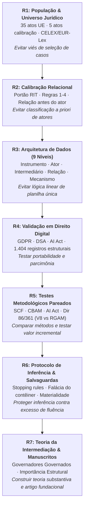

# PRJ-David — Arquitetura de Governança & Intermediação Regulatória
## Organização Histórica dos Trabalhos e Catálogo de Produtos Gerados (R1–R7)

> **Mola Mestre do Projeto:** A organização deste repositório reflete fielmente a evolução histórica e cumulativa da pesquisa conduzida por Igor Caires Machado em diálogo com David Levi-Faur e Rotem Medzini, conforme sintetizado na apresentação analítica [Igor_Work_R1_R7_UPDATED_READABLE.pptx](file:///g:/Meu%20Drive/PRJ-David/Prf-David/90_COMUNICACOES_E_DESPACHOS/01_Apresentacoes_David/ARQUIVOS_DAVID/Igor_Work_R1_R7_UPDATED_READABLE.pptx).

---

## 📌 Acesso rápido — manuscritos e interfaces HTML (13/10/2026)

### Manuscritos teóricos de David (versões de trabalho)

| Versão | Documento | Local e descrição |
|---|---|---|
| **Draft V8 (David Levi-Faur)** | [Abrir DOCX V8 no próprio repositório](https://github.com/PRJ-REGULATORY-INTERMEDIARIES/Prf-David/blob/main/06_R6_ARCHITECTURAL_INFERENCE_SAFEGUARDS/01_RGAM_Materiality_First/RGAM/source_context/david_v8_2026-10-03/draft%20v8%20%20%20Law_and_Governance_Architectures_Revised.docx) | Versão do manuscrito *Law and Governance Architectures*, preservada como fonte em R6; referência editorial para o desenvolvimento metodológico. |
| **Draft V9 (anotação de Igor sobre V8)** | [Abrir DOCX V9 no Google Drive](https://docs.google.com/document/d/1jSo_YRa6f-LpYiNtcgWdZFRKvs8rO55G/view) | Arquivo **externo ao GitHub**, com sugestões e comentários propostos por Igor (inclusive à luz das contribuições de Ivana e Rotem). **Não é nova versão aprovada por David**. |

> **Atenção editorial e de acesso:** os dois documentos são **rascunhos de trabalho**, não publicações científicas finais. O repositório GitHub é público. O V9 está armazenado no Drive e possui permissões de compartilhamento próprias: revisar essas permissões antes de divulgação ampla. Este README **não** importa, publica ou substitui o arquivo V9 no repositório.

### Catálogo de interfaces HTML navegáveis

Inventário das **interfaces HTML com finalidade de apresentação, revisão ou discussão** identificadas no repositório (cópias com a mesma finalidade estão indicadas na linha correspondente). Não confundir esses artefatos com os numerosos HTMLs de **textos legislativos originais, capturas de páginas, evidências e fragmentos de template** preservados para auditoria.

| Interface | O que apresenta | Acesso | Status/finalidade |
|---|---|---|---|
| **Atlas Rotem–Igor (apresentação atual)** | Compara dinamicamente os desenhos de pesquisa de Rotem Medzini e Igor Caires Machado/David Levi-Faur; oferece fluxogramas, seleção dos quatro casos (Diretiva 86/361/CEE, AI Act, SCF e CBAM), matriz de convergências e limites da comparação, com alternância inglês/português. | [Abrir arquivo no GitHub](https://github.com/PRJ-REGULATORY-INTERMEDIARIES/Prf-David/blob/main/docs/rotem-igor-comparison/index.html) · [Pré-visualizar no navegador](https://htmlpreview.github.io/?https://raw.githubusercontent.com/PRJ-REGULATORY-INTERMEDIARIES/Prf-David/main/docs/rotem-igor-comparison/index.html) | Apresentação atual; HTML versionado em `main`; **GitHub Pages ainda não confirmado como publicado**. |
| **Artigo interativo V8 — From Legal Text to Governance Architecture** | Apresenta a passagem de disposições jurídicas para arquitetura de governança, operações inferenciais, escolhas interativas de elementos, comparação multidimensional e exemplo de cooperação/consistência do GDPR. | [Abrir arquivo no GitHub](https://github.com/PRJ-REGULATORY-INTERMEDIARIES/Prf-David/blob/main/06_R6_ARCHITECTURAL_INFERENCE_SAFEGUARDS/01_RGAM_Materiality_First/RGAM/V8_ACTIVE/06_INTERACTIVE_ARTICLE/index.html) · [Pré-visualizar no navegador](https://htmlpreview.github.io/?https://raw.githubusercontent.com/PRJ-REGULATORY-INTERMEDIARIES/Prf-David/main/06_R6_ARCHITECTURAL_INFERENCE_SAFEGUARDS/01_RGAM_Materiality_First/RGAM/V8_ACTIVE/06_INTERACTIVE_ARTICLE/index.html) | Interface de pesquisa no diretório `V8_ACTIVE`; o nome da pasta **não** comprova que haja um website público ativo. |
| **R4.2B — Human QA Review Panel** | Painel de revisão da extração: confronta fonte jurídica congelada, contexto anterior/posterior e saída de extração, disponibilizando campos para avaliação do pesquisador. | [Abrir arquivo no GitHub](https://github.com/PRJ-REGULATORY-INTERMEDIARIES/Prf-David/blob/main/04_R4_DIGITAL_LAW_VALIDATION/01_Extracao_Estrutural_Cross_Domain/R4_CROSS_DOMAIN_VALIDATION/03_extraction/qa/human_review/R4_2B_HUMAN_REVIEW_PANEL.html) · [Pré-visualizar no navegador](https://htmlpreview.github.io/?https://raw.githubusercontent.com/PRJ-REGULATORY-INTERMEDIARIES/Prf-David/main/04_R4_DIGITAL_LAW_VALIDATION/01_Extracao_Estrutural_Cross_Domain/R4_CROSS_DOMAIN_VALIDATION/03_extraction/qa/human_review/R4_2B_HUMAN_REVIEW_PANEL.html) | Ferramenta de QA; [cópia no pacote de envio a David](https://github.com/PRJ-REGULATORY-INTERMEDIARIES/Prf-David/blob/main/04_R4_DIGITAL_LAW_VALIDATION/02_Pacote_Envio_David_R4/ENVIO_R4_TO_DAVID/05_QA_AND_HUMAN_ADJUDICATION/human_review_interface/R4_2B_HUMAN_REVIEW_PANEL.html). |
| **R4.2D — Human Diagnostic Panel** | Diagnóstico de possíveis defeitos de extração apoiados por comparação entre modelos, com texto jurídico, campos de correção e espaço para decisão fundamentada do pesquisador. | [Abrir arquivo no GitHub](https://github.com/PRJ-REGULATORY-INTERMEDIARIES/Prf-David/blob/main/04_R4_DIGITAL_LAW_VALIDATION/01_Extracao_Estrutural_Cross_Domain/R4_CROSS_DOMAIN_VALIDATION/03_extraction/qa/repair/R4_2D_HUMAN_DIAGNOSTIC_PANEL.html) · [Pré-visualizar no navegador](https://htmlpreview.github.io/?https://raw.githubusercontent.com/PRJ-REGULATORY-INTERMEDIARIES/Prf-David/main/04_R4_DIGITAL_LAW_VALIDATION/01_Extracao_Estrutural_Cross_Domain/R4_CROSS_DOMAIN_VALIDATION/03_extraction/qa/repair/R4_2D_HUMAN_DIAGNOSTIC_PANEL.html) | Ferramenta de diagnóstico; [cópia no pacote de envio a David](https://github.com/PRJ-REGULATORY-INTERMEDIARIES/Prf-David/blob/main/04_R4_DIGITAL_LAW_VALIDATION/02_Pacote_Envio_David_R4/ENVIO_R4_TO_DAVID/05_QA_AND_HUMAN_ADJUDICATION/R4_2D_human_diagnostic/R4_2D_HUMAN_DIAGNOSTIC_PANEL.html). |
| **Regulatory Intermediation — Discussion Panel** | Painel de discussão sobre a fronteira da intermediação regulatória, questões conceituais e casos-limite (consultas, informação científica, verificadores independentes e outras posições). | [Abrir arquivo no GitHub](https://github.com/PRJ-REGULATORY-INTERMEDIARIES/Prf-David/blob/main/90_COMUNICACOES_E_DESPACHOS/02_Historico_Envios_e_Reunioes/Enviados/Reuni%C3%A3o%20-%2012-09-2026/regulatory_intermediation_discussion_panel_light.html) · [Pré-visualizar no navegador](https://htmlpreview.github.io/?https://raw.githubusercontent.com/PRJ-REGULATORY-INTERMEDIARIES/Prf-David/main/90_COMUNICACOES_E_DESPACHOS/02_Historico_Envios_e_Reunioes/Enviados/Reuni%C3%A3o%20-%2012-09-2026/regulatory_intermediation_discussion_panel_light.html) | Material de discussão acadêmica, não instrumento final de codificação. |

**Como abrir:** o link **“Abrir arquivo no GitHub”** leva ao arquivo versionado (o GitHub normalmente mostra o código-fonte HTML); **“Pré-visualizar no navegador”** utiliza o serviço **externo** [GitHub HTML Preview](https://htmlpreview.github.io/) para tentar renderizar a interface, sem pressupor GitHub Pages ativo. Para execução independente, baixar o HTML e abri-lo localmente no navegador. Painéis de revisão e exportação de decisões devem ser testados localmente antes de serem utilizados para registrar trabalho científico; uma página HTML não implica revisão ou validação concluída.

### Qual apresentação está atual? E o GitHub Pages?

- **Atual nesta série de comparações:** [Atlas interativo Rotem–Igor](https://github.com/PRJ-REGULATORY-INTERMEDIARIES/Prf-David/blob/main/docs/rotem-igor-comparison/index.html), localizado em `docs/rotem-igor-comparison/index.html`, na branch `main`.
- **Situação da hospedagem GitHub Pages (verificação de 13/10/2026):** **não confirmada como ativa**. A existência dos arquivos HTML no GitHub não significa que exista um site hospedado. O endereço esperado **após a habilitação e verificação** é `https://prj-regulatory-intermediaries.github.io/Prf-David/rotem-igor-comparison/`.
- **Para ativar na interface do GitHub:** [Settings → Pages](https://github.com/PRJ-REGULATORY-INTERMEDIARIES/Prf-David/settings/pages) → `Deploy from a branch` → `main` → `/docs`. Confirmar a URL publicada antes de distribuí-la como link do site.
- **Nota de escopo:** a publicação somente de `/docs` não disponibiliza automaticamente, via Pages, as interfaces históricas situadas nas pastas R4, R6 e 90; seus links acima abrem os arquivos no repositório ou usam um visualizador externo.

---

### 🗺️ Visão Geral do Pipeline Cumulativo (R1 → R7)



---

## 📂 Mapa de Pastas e Produtos Gerados

```
Prf-David/
│
├── 00_GOVERNANCA_AUDITORIA_E_CONTROLE/        ← Registros de auditoria, closeout e relatórios de estado
│   ├── 01_Audit_Research_History/             ← Inventário completo de arquivos, git diffs e histórico de agentes
│   ├── 02_Relatorios_de_Estado/               ← Relatórios de estado consolidados do projeto e auditoria git
│   └── 03_Registros_de_Governanca_e_Closeout/ ← Protocolos de closeout, suspensão, external review e recovery
│
├── 01_R1_POPULATION_LEGAL_UNIVERSE/           ← [R1] Universo Jurídico & Construção da População
│   ├── 01_Corpus_EUR_Lex/                     ← Datasets EUR-Lex, extrações brutas e cleanroom
│   ├── 02_Estudos_Preliminares_e_Testes/      ← Testes iniciais de seleção amostral e viés
│   └── 03_Inputs_e_Exercicios/                ← Exercícios de população e inputs documentais
│
├── 02_R2_RELATIONAL_CALIBRATION/              ← [R2] Calibração Relacional & Portão RIT
│   ├── 01_Notas_Metodologicas_e_Regras/       ← Notas de calibração v1.3, regras 1 a 4 e discussões
│   └── 02_Pilotos_R2_1_e_Calibracao/          ← Protocolo PILOT_R2_1 e calibração de papéis relacionais
│
├── 03_R3_DATASET_ARCHITECTURE_LEXIMETRICS/    ← [R3] Arquitetura de Dados em 9 Níveis & Leximetria
│   ├── 01_Relational_Leximetrics_Pilots/      ← Pilotos 01, 02 e 03 (com 19 adjudicações humanas e A/B)
│   └── 02_Colaboracao_Rotem_Medzini/          ← Pacotes de compartilhamento e comparação Codex/Rotem
│
├── 04_R4_DIGITAL_LAW_VALIDATION/              ← [R4] Validação em Legislação Digital (Portabilidade)
│   ├── 01_Extracao_Estrutural_Cross_Domain/   ← Validação em GDPR, DSA e AI Act (1.404 registros)
│   └── 02_Pacote_Envio_David_R4/              ← Pacote de envio consolidado para David Levi-Faur (com hash)
│
├── 05_R5_PAIRED_METHODOLOGICAL_TESTS/         ← [R5] Testes Pareados dos 4 Casos & Pilotos Comparativos
│   ├── 01_Teste_3x3_Quatro_Casos/             ← New Test 3x3: SCF, CBAM, AI Act, Dir 86/361 (etapas 00 a 16)
│   ├── 02_Pilotos_Comparativos_V8/            ← Comparativos MDR, DSA, Lei 13.848 e replicação Claude/Codex
│   └── 03_Protocolos_e_Registros_V8/          ← Protocolo V8_COMP_01, logs de execução e registros de decisão
│
├── 06_R6_ARCHITECTURAL_INFERENCE_SAFEGUARDS/  ← [R6] Protocolo de Inferência & Salvaguardas Metodológicas
│   ├── 01_RGAM_Materiality_First/             ← Protocolo RGAM Materiality-First, ontologia v0.4 e handoff
│   └── 02_Validacao_e_Stress_Tests/           ← Matriz de fontes, testes de estresse e rastreamento de revisões
│
├── 07_R7_SUBSTANTIVE_INTERMEDIATION_PAPERS/   ← [R7] Teoria Substantiva da Intermediação & Manuscritos
│   ├── 01_Pacote_Sintese_Final/               ← Síntese dos 4 casos, governadores governados e agenda teórica
│   └── 02_Foundational_Paper_Review/          ← Diagnóstico científico V6, arquitetura editorial e protocolo empírico
│
├── 90_COMUNICACOES_E_DESPACHOS/               ← Apresentações, e-mails, atas e histórico de reuniões
│   ├── 01_Apresentacoes_David/                ← Igor_Work_R1_R7_UPDATED_READABLE.pptx e decks de David
│   └── 02_Historico_Envios_e_Reunioes/        ← Registro de chats, e-mails de envio e atas de reuniões
│
└── 99_REFERENCIAS_E_BIBLIOGRAFIA/             ← Referencial teórico e prompts arquiteturais
    ├── 01_Bibliografia/                       ← Literatura em Governança Regulatória e Arquitetura Institucional
    └── 02_Arquitetura_de_Trabalho/            ← Desenhos de trabalho e prompts operacionais
```

---

## 📋 Catálogo Detalhado de Produtos Gerados por Rodada

| Rodada | Produto Gerado Principal | Localização no Repositório | Descrição e Contribuição Metodológica |
|---|---|---|---|
| **R1** | **Corpus EUR-Lex & População de Atos** | [`01_R1_POPULATION_LEGAL_UNIVERSE/`](file:///g:/Meu%20Drive/PRJ-David/Prf-David/01_R1_POPULATION_LEGAL_UNIVERSE/) | Definição rigorosa do universo de 35 atos elegíveis da UE e corpus de calibração de 5 casos via CELEX oficial, separando população de codificação substantiva. |
| **R2** | **Portão RIT & Regras de Calibração Relacional** | [`02_R2_RELATIONAL_CALIBRATION/`](file:///g:/Meu%20Drive/PRJ-David/Prf-David/02_R2_RELATIONAL_CALIBRATION/) | Estabelecimento das Regras 1 a 4 (saídas não-vinculantes, expertise institucionalizada, papéis relação-específicos, alvos trans-dispositivos). Relação antes do ator. |
| **R3** | **Arquitetura de Dados em 9 Níveis & Leximetria** | [`03_R3_DATASET_ARCHITECTURE_LEXIMETRICS/`](file:///g:/Meu%20Drive/PRJ-David/Prf-David/03_R3_DATASET_ARCHITECTURE_LEXIMETRICS/) | Modelo relacional multinível (Instrumento, Ator, Intermediário, Relação, Evento, Configuração, Aresta, Evidência, Proveniência) e 19 decisões adjudicadas humanamente. |
| **R4** | **Validação em Direito Digital & Portabilidade** | [`04_R4_DIGITAL_LAW_VALIDATION/`](file:///g:/Meu%20Drive/PRJ-David/Prf-David/04_R4_DIGITAL_LAW_VALIDATION/) | Extração e teste de portabilidade em GDPR, DSA e AI Act com 1.404 registros estruturais, 143 revisões avançadas e pacote com hash SHA-256 para David. |
| **R5** | **Teste Metodológico Pareado dos 4 Casos** | [`05_R5_PAIRED_METHODOLOGICAL_TESTS/`](file:///g:/Meu%20Drive/PRJ-David/Prf-David/05_R5_PAIRED_METHODOLOGICAL_TESTS/) | Experimento comparativo estrito entre Baseline V8 e RGAM Controlado em 4 casos (SCF, CBAM, AI Act, Dir 86/361), além de pilotos comparativos (MDR, DSA, Lei 13.848). |
| **R6** | **Protocolo de Inferência & Salvaguardas** | [`06_R6_ARCHITECTURAL_INFERENCE_SAFEGUARDS/`](file:///g:/Meu%20Drive/PRJ-David/Prf-David/06_R6_ARCHITECTURAL_INFERENCE_SAFEGUARDS/) | Salvaguardas contra sobre-inferência (*falácia do contêiner*, dependências externas, regras de parada relação → configuração → arquitetura) e ontologia RGAM v0.4. |
| **R7** | **Teoria Substantiva & Artigo Fundacional** | [`07_R7_SUBSTANTIVE_INTERMEDIATION_PAPERS/`](file:///g:/Meu%20Drive/PRJ-David/Prf-David/07_R7_SUBSTANTIVE_INTERMEDIATION_PAPERS/) | Síntese substantiva (*Governadores Governados*, importância estrutural, hierarquia + intermediação), diagnóstico científico V6 e arquitetura editorial do paper fundacional. |
| **Transversal** | **Auditoria, Governança & Despachos** | [`00_GOVERNANCA_AUDITORIA_E_CONTROLE/`](file:///g:/Meu%20Drive/PRJ-David/Prf-David/00_GOVERNANCA_AUDITORIA_E_CONTROLE/) e [`90_COMUNICACOES_E_DESPACHOS/`](file:///g:/Meu%20Drive/PRJ-David/Prf-David/90_COMUNICACOES_E_DESPACHOS/) | Registros de auditoria completa, relatórios de estado, hold notices, pacotes de revisão externa e apresentação executiva dos slides R1–R7 de David. |

---

### 🔑 As Quatro Lições dos Casos (Slide 17) e Salvaguardas (Slide 18)

1. **SCF (Social Climate Fund):** Evitar a *Falácia do Contêiner* (um regulamento não equivale automaticamente a uma única arquitetura de governança).
2. **CBAM (Mecanismo de Ajuste Carbónico Fronteiriço):** *Precisão Relacional* (atores nomeados e contrapartes específicas importam criticamente).
3. **AI Act (Regulamento de IA):** *Alerta de Granularidade* (mais detalhes nem sempre produzem melhor inferência).
4. **Directiva 86/361 (Equipamentos Terminais):** *Dependências Externas* (regra de parada quando o texto legal remete a estruturas externas).

